# Java Design Patterns - Interactive Travel Planner


A desktop Travel Planner and live weather simulation application built with Java Swing and Gson. Designed to practice five classic Gang of Four (GoF) design patterns (Singleton, Strategy, Iterator, Observer, Decorator) in an interactive application with custom Java 2D charts and multithreaded simulation.

---

## Key Features

- **Centralized JSON Data Store (Singleton):** Parses city metadata (`name`, `population`, `area`, `currentTemperature`, `currentWeatherState`) from `cities.json` once into a thread-safe in-memory repository.
- **Pluggable Runtime Sorting (Strategy):** Switch dynamically between alphabetical sorting, descending population sorting, and descending land-area sorting without modifying client code.
- **Real-Time Search & Weather Filtering (Iterator):** Instant substring search across cities plus custom weather-specific iterators (`Sunny`, `Cloudy`, `Rainy`, `Snowy`, or `All`) that stay synchronized with live weather changes.
- **Composable Trip Cost & Duration Calculator (Decorator):** Wrap any base city visit with optional activities (*Museum Visit*, *City Center Walk*, *Shopping Mall*, *Park Walk*) to compute cumulative duration and formatted USD cost on the fly, and export itineraries to `.txt` files.
- **Asynchronous Weather Simulation & Custom AWT Charts (Observer):** A background daemon thread (`WeatherStation`) updates temperatures and weather states every 3 seconds and broadcasts notifications to custom-rendered Swing bar and pie chart panels as well as the live weather filter list via the Event Dispatch Thread (EDT).

---

## GoF Design Patterns Architecture

| GoF Pattern | Category | Role / Contract | Concrete Classes | Architectural Responsibility |
| :--- | :--- | :--- | :--- | :--- |
| **Singleton** | Creational | `CityRepository` | `CityRepository` | Guarantees a single globally shared repository instance initialized lazily via `synchronized getInstance()`. Loads `cities.json` once via Gson `TypeToken` and serves defensive copies (`new ArrayList<>(cities)`) for thread-safe concurrent access. |
| **Strategy** | Behavioral | `SortStrategy` | `NameSortStrategy`, `PopulationSortStrategy`, `AreaSortStrategy` | Encapsulates interchangeable sorting algorithms behind a common `sort(List<City>)` interface, adhering to the Open/Closed Principle when switching sort modes in the UI. |
| **Iterator** | Behavioral | `CityIterator` | `SunnyCityIterator`, `CloudyCityIterator`, `RainyCityIterator`, `SnowyCityIterator` | Abstracts weather-predicate traversal (`hasNext()`, `next()`) over city snapshots without exposing underlying collection filtering logic to the Swing view. |
| **Observer** | Behavioral | `WeatherSubject`, `WeatherObserver` | Publisher: `WeatherStation` (`implements WeatherSubject, Runnable`)<br>Observers: `TemperatureBarChartPanel`, `WeatherPieChartPanel`, `TravelPlannerApp` | Decouples the asynchronous 3-second weather simulation daemon thread from dependent UI views. Observers receive `update()` signals and marshal UI repaints/list refreshes safely onto the Swing EDT. |
| **Decorator** | Structural | `VisitPlan`, `VisitDecorator` | Base Component: `BaseCityVisit`<br>Decorators: `MuseumVisit`, `CityCenterVisit`, `ShoppingMallVisit`, `ParkVisit` | Dynamically stacks optional travel activities around a city's population-scaled base visit plan to accumulate descriptions, hours, and costs without subclass explosion. |

---

## Class Diagram

```mermaid
classDiagram
    direction TB

    %% Domain & Singleton
    class WeatherState {
        <<enumeration>>
        SUNNY
        CLOUDY
        RAINY
        SNOWY
    }

    class City {
        -String name
        -int population
        -double area
        -double currentTemperature
        -WeatherState currentWeatherState
        +getName() String
        +getPopulation() int
        +getArea() double
        +getCurrentTemperature() double
        +setCurrentTemperature(double) void
        +getCurrentWeatherState() WeatherState
        +setCurrentWeatherState(WeatherState) void
        +toString() String
    }

    class CityRepository {
        <<Singleton>>
        -CityRepository instance$
        -List~City~ cities
        -CityRepository()
        +getInstance()$ CityRepository
        -loadCitiesFromJson() void
        +getCities() List~City~
        +sortCities(SortStrategy) void
    }

    CityRepository "1" *-- "*" City : caches
    City --> WeatherState : currentWeatherState

    %% Strategy Pattern
    class SortStrategy {
        <<interface>>
        +sort(List~City~ cities) void
    }

    class NameSortStrategy {
        +sort(List~City~ cities) void
    }
    class PopulationSortStrategy {
        +sort(List~City~ cities) void
    }
    class AreaSortStrategy {
        +sort(List~City~ cities) void
    }

    SortStrategy <|.. NameSortStrategy
    SortStrategy <|.. PopulationSortStrategy
    SortStrategy <|.. AreaSortStrategy

    %% Iterator Pattern
    class CityIterator {
        <<interface>>
        +hasNext() boolean
        +next() City
    }

    class SunnyCityIterator {
        -List~City~ cities
        -int position
        +hasNext() boolean
        +next() City
    }
    class CloudyCityIterator {
        -List~City~ cities
        -int position
        +hasNext() boolean
        +next() City
    }
    class RainyCityIterator {
        -List~City~ cities
        -int position
        +hasNext() boolean
        +next() City
    }
    class SnowyCityIterator {
        -List~City~ cities
        -int position
        +hasNext() boolean
        +next() City
    }

    CityIterator <|.. SunnyCityIterator
    CityIterator <|.. CloudyCityIterator
    CityIterator <|.. RainyCityIterator
    CityIterator <|.. SnowyCityIterator

    %% Observer Pattern & Concurrency
    class Runnable {
        <<interface>>
        +run() void
    }

    class WeatherSubject {
        <<interface>>
        +attach(WeatherObserver observer) void
        +detach(WeatherObserver observer) void
        +notifyObservers() void
    }

    class WeatherObserver {
        <<interface>>
        +update() void
    }

    class WeatherStation {
        -List~WeatherObserver~ observers
        -Random random
        +attach(WeatherObserver observer) void
        +detach(WeatherObserver observer) void
        +notifyObservers() void
        +run() void
        -changeWeatherRandomly() void
    }

    class TemperatureBarChartPanel {
        +update() void
        #paintComponent(Graphics g) void
    }

    class WeatherPieChartPanel {
        +update() void
        #paintComponent(Graphics g) void
        -drawLegendItem(Graphics2D, String, Color, int, int) void
    }

    WeatherSubject <|.. WeatherStation
    Runnable <|.. WeatherStation
    WeatherObserver <|.. TemperatureBarChartPanel
    WeatherObserver <|.. WeatherPieChartPanel
    WeatherStation --> "*" WeatherObserver : notifies

    %% Decorator Pattern
    class VisitPlan {
        <<interface>>
        +getDescription() String
        +getCost() double
        +getTime() double
    }

    class BaseCityVisit {
        -City city
        +BaseCityVisit(City city)
        +getDescription() String
        +getCost() double
        +getTime() double
    }

    class VisitDecorator {
        <<abstract>>
        #VisitPlan wrappedPlan
        +VisitDecorator(VisitPlan planToWrap)
        +getDescription() String
        +getCost() double
        +getTime() double
    }

    class MuseumVisit {
        +getDescription() String
        +getCost() double
        +getTime() double
    }
    class CityCenterVisit {
        +getDescription() String
        +getCost() double
        +getTime() double
    }
    class ShoppingMallVisit {
        +getDescription() String
        +getCost() double
        +getTime() double
    }
    class ParkVisit {
        +getDescription() String
        +getCost() double
        +getTime() double
    }

    VisitPlan <|.. BaseCityVisit
    VisitPlan <|.. VisitDecorator
    VisitDecorator o-- VisitPlan : wraps
    VisitDecorator <|-- MuseumVisit
    VisitDecorator <|-- CityCenterVisit
    VisitDecorator <|-- ShoppingMallVisit
    VisitDecorator <|-- ParkVisit
    BaseCityVisit --> City : inspects

    %% Main Swing Client
    class TravelPlannerApp {
        -List~City~ cities
        -JTextField searchField
        -JComboBox~String~ sortComboBox
        -JComboBox~String~ weatherComboBox
        -JList~City~ allCitiesList
        -JList~City~ filteredCitiesList
        +TravelPlannerApp()
        +main(String[] args)$ void
        -updateAllCitiesList() void
        -updateFilteredCitiesList() void
        -updatePlanner() void
        -saveTripPlan() void
    }

    TravelPlannerApp --> CityRepository : uses
    TravelPlannerApp --> SortStrategy : executes
    TravelPlannerApp --> CityIterator : filters with
    TravelPlannerApp --> VisitPlan : composes
    TravelPlannerApp *-- TemperatureBarChartPanel : contains
    TravelPlannerApp *-- WeatherPieChartPanel : contains
    TravelPlannerApp --> WeatherStation : starts daemon
```



---

## Project Structure

```text
java-design-patterns-travel-planner/
├── cities.json                        # Seed dataset of 10 cities with initial weather & demographics
├── lib/
│   └── gson-2.10.1.jar                # Google Gson library for JSON deserialization
├── src/
│   ├── City.java                      # Encapsulated domain model with thread-safe weather accessors
│   ├── WeatherState.java              # Weather condition enum (SUNNY, CLOUDY, RAINY, SNOWY)
│   ├── CityRepository.java            # [Singleton] Centralized JSON loader & thread-safe city cache
│   ├── SortStrategy.java              # [Strategy] Sorting contract
│   ├── NameSortStrategy.java          # [Strategy] Case-insensitive alphabetical sort
│   ├── PopulationSortStrategy.java    # [Strategy] Descending population sort
│   ├── AreaSortStrategy.java          # [Strategy] Descending surface-area sort
│   ├── CityIterator.java              # [Iterator] Custom traversal interface
│   ├── SunnyCityIterator.java         # [Iterator] Filters SUNNY cities
│   ├── CloudyCityIterator.java        # [Iterator] Filters CLOUDY cities
│   ├── RainyCityIterator.java         # [Iterator] Filters RAINY cities
│   ├── SnowyCityIterator.java         # [Iterator] Filters SNOWY cities
│   ├── WeatherSubject.java            # [Observer] Publisher contract
│   ├── WeatherObserver.java           # [Observer] Subscriber contract
│   ├── WeatherStation.java            # [Observer] Background Runnable weather simulator (3s cycle)
│   ├── TemperatureBarChartPanel.java  # [Observer] Live custom-painted AWT temperature bar chart
│   ├── WeatherPieChartPanel.java      # [Observer] Live custom-painted AWT weather distribution pie chart
│   ├── VisitPlan.java                 # [Decorator] Trip component interface
│   ├── BaseCityVisit.java             # [Decorator] Population-scaled base visit component
│   ├── VisitDecorator.java            # [Decorator] Abstract wrapper delegating to VisitPlan
│   ├── MuseumVisit.java               # [Decorator] +$15.00, +2.0 hours
│   ├── CityCenterVisit.java           # [Decorator] +$10.00, +2.0 hours
│   ├── ShoppingMallVisit.java         # [Decorator] +$50.00, +3.0 hours
│   ├── ParkVisit.java                 # [Decorator] +$0.00,  +1.5 hours
│   └── TravelPlannerApp.java          # Main Swing JFrame integrating all 5 GoF patterns
├── run.bat                            # One-click compile & run script for Windows
├── run.sh                             # One-click compile & run script for Linux / macOS
└── LICENSE                            # MIT License
```

---

## Getting Started

### Prerequisites

- **JDK 11 or newer** (tested on Java 21 LTS; compatible with JDK 8+).
- `cities.json` remains in the project root directory (working directory when launching the app).

### Quick Start (Recommended)

**Windows (Command Prompt / PowerShell):**
```bat
.\run.bat
```

**Linux / macOS:**
```bash
chmod +x run.sh
./run.sh
```

### Manual Compilation & Execution

**Windows:**
```powershell
mkdir out
javac -encoding UTF-8 -cp "lib/gson-2.10.1.jar" -d out src/*.java
java -Dfile.encoding=UTF-8 -cp "out;lib/gson-2.10.1.jar" TravelPlannerApp
```

**Linux / macOS:**
```bash
mkdir -p out
javac -encoding UTF-8 -cp "lib/gson-2.10.1.jar" -d out src/*.java
java -Dfile.encoding=UTF-8 -cp "out:lib/gson-2.10.1.jar" TravelPlannerApp
```

---

## Concurrency & Thread-Safety Design

Because `WeatherStation` mutates weather states on an asynchronous daemon `Thread` while the user interacts with sorting, searching, and filtering controls on the **Swing Event Dispatch Thread (EDT)**:

1. **Defensive Snapshots:** `CityRepository.getCities()` and `CityRepository.sortCities(...)` are `synchronized`, and `getCities()` returns a defensive `new ArrayList<>(cities)` copy so background weather updates and custom `CityIterator` traversals never conflict with in-place `Collections.sort(...)` calls (`ConcurrentModificationException`-free).
2. **Synchronized Mutable Fields:** `City` synchronizes reads and writes to `currentTemperature` and `currentWeatherState` to guarantee cross-thread visibility.
3. **EDT-Safe UI Updates:** All `WeatherObserver` callbacks marshal Swing component mutations (`repaint()` and live `filteredCitiesList` refreshes) onto the EDT via `SwingUtilities.invokeLater(...)`.

---

## License

Released under the [MIT License](LICENSE). Copyright (c) 2026 Berke Cinkol.
